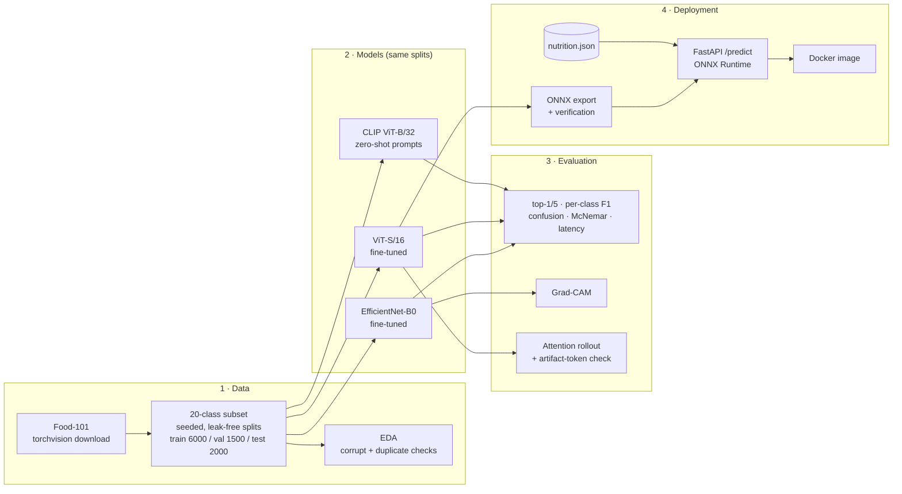
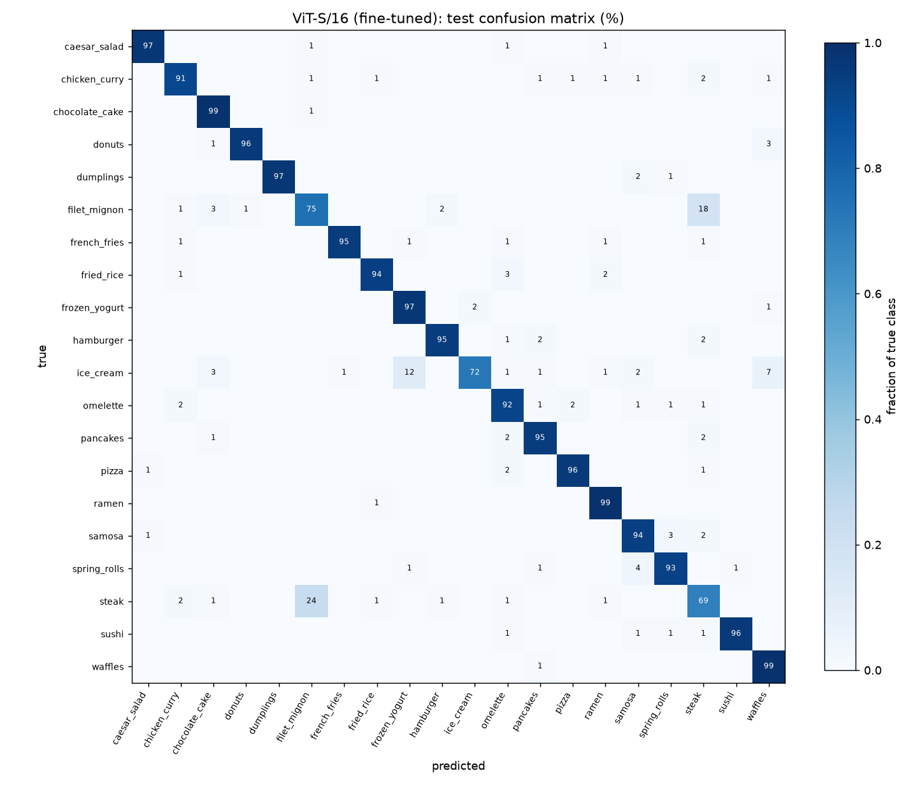
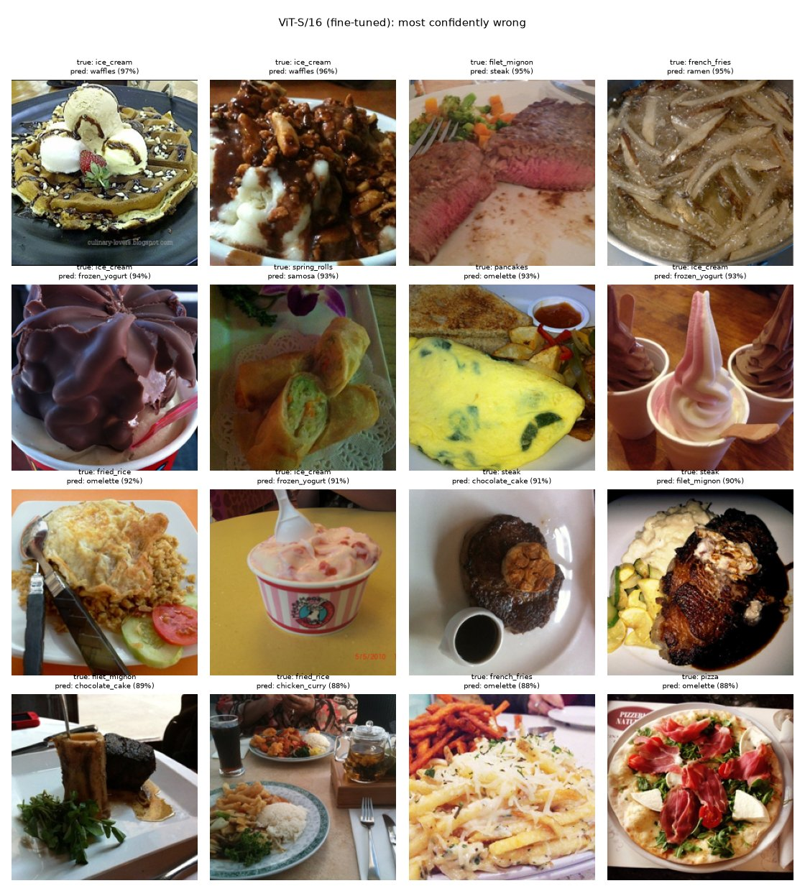
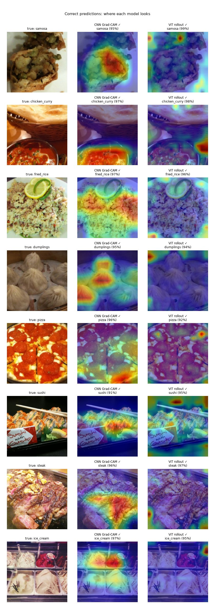

# food-vision

**Food recognition with nutritional insights: a fine-tuned CNN vs a fine-tuned ViT vs zero-shot CLIP on Food-101, served as an ONNX + FastAPI service.**

Upload a photo of a dish → get the top-3 predicted dishes with confidence and approximate nutrition per serving.

| | |
|---|---|
| **Task** | 20-class food classification (Food-101 subset incl. samosa, chicken curry, fried rice, dumplings) |
| **Best accuracy** | 92.7% top-1 (zero-shot CLIP), statistically tied with a fine-tuned ViT-S/16 at 92.1% |
| **Deployed model** | ViT-S/16 → ONNX (100% top-1 agreement with PyTorch on the 2,000 test images) |
| **Serving** | FastAPI, Docker, ONNX Runtime, no PyTorch in the image |
| **Multi-food detection** | YOLO11n (COCO) food regions → each crop classified by the ViT (`POST /detect`) |
| **Quality** | 93 pytest tests, split leakage checks, McNemar significance tests |

> ⚠️ Nutrition values are **approximate reference values for a typical serving**, not measurements of the pictured food. See [Nutrition](#nutrition).

---

## Background: the published paper

This project is a rebuild of my final-year project and its published paper:

> **An Integrated Framework for Food Recognition, Nutritional Insights, and Meal Recording.**
> <!-- TODO(author): add authors, venue, year and DOI/link -->
> _Authors, venue, year and link: to be added._

The original work combined food recognition, nutrition lookup and meal recording. This version rebuilds the recognition and nutrition parts as an engineering-grade pipeline:

* reproducible data splits;
* three model families compared under identical evaluation, with significance testing;
* explainability, including an analysis of where it misleads;
* a verified ONNX export served through a containerised API.

## Architecture



**Request path:** `POST /predict` (image) → decode + validate → resize and center-crop (NumPy/PIL, identical to torchvision, unit-tested) → ONNX Runtime → softmax top-k → nutrition lookup → JSON.

## Results

All numbers come from the recorded runs (`runs/*/test_metrics.json`, `reports/eval/`, `reports/deploy/`), on the held-out **test split: 2,000 images, 100 per class**. Trained on an Apple Silicon Mac (MPS, fp16 mixed precision).

| Model | Training | Params (inference) | Top-1 | Top-5 | Macro-F1 | Latency MPS (mean / p95) | Latency CPU (mean / p95) |
|---|---|---|---|---|---|---|---|
| EfficientNet-B0 | fine-tuned, 15 epochs (17.5 min) | 4.0M | 90.45% | 98.30% | 0.905 | 5.0 / 5.2 ms | 102.5 / 103.6 ms* |
| ViT-S/16 | fine-tuned, 9 epochs, early stop (12.2 min) | 21.7M | 92.05% | 99.25% | 0.920 | 6.7 / 6.9 ms | 13.7 / 14.0 ms |
| CLIP ViT-B/32 | **none (zero-shot)** | 87.8M (image encoder) | **92.70%** | **99.65%** | **0.927** | 9.0 / 9.2 ms | 21.0 / 21.6 ms |

Latency: batch 1, fp32, forward pass only, mean / p95 over 50 runs after warm-up.
\* This PyTorch build has no oneDNN, so depthwise convolutions take a slow CPU fallback path (verified with the profiler). With ONNX Runtime the same CNN runs in 5.9 ms on CPU; see [Deployment](#deployment).

**Are the differences real?** Exact McNemar tests on the paired test predictions:

| Comparison | Only A correct | Only B correct | p-value |
|---|---|---|---|
| EfficientNet-B0 vs ViT-S/16 | 67 | 98 | 0.019 |
| EfficientNet-B0 vs CLIP | 78 | 122 | 0.002 |
| ViT-S/16 vs CLIP | 81 | 94 | **0.364 (no significant difference)** |

**Takeaways**

* **Zero-shot CLIP matches a ViT fine-tuned on 6,000 images.** CLIP never saw a training image; its prompts are just "a photo of {dish}, a type of food" and three variants.
* **The ViT beats the CNN** (p = 0.019) and converges faster (best val at epoch 5 vs 12).
* **The fine-tuned models overfit:** train top-1 reaches about 99% while val levels off at 86–89%, even with augmentation and label smoothing. With only 300 images per class, pretraining matters more than architecture.
* **Test scores are 3.0–4.1 points higher than val scores for all three models**, including zero-shot CLIP, which used neither split. This matches how Food-101 was built: test images were manually cleaned, while training images (where val comes from) were left noisy on purpose.

## Error analysis

<p align="center"></p>

1. **steak ↔ filet mignon is the dominant error for all three models**: 42–43 errors each, about a quarter of all ViT errors. ViT recall is 69% on steak and 75% on filet mignon. This is fine-grained: filet mignon *is* a cut of steak, and plated photos look alike.
2. **ice cream → frozen yogurt** is the second-largest confusion and is **worst for zero-shot CLIP** (25 ice-cream images called frozen yogurt, against 12 for the fine-tuned ViT). Text prompts can't separate two visually identical desserts; labelled data can.
3. **Many confident errors are multi-dish photos**: ice cream served *on* waffles labelled "waffles", a pastry beside a salad. A single label can't describe such images, which motivates v2 below.
4. **49 test images are misclassified by every model** (`reports/eval/all_wrong.jpg`), several with questionable ground-truth labels.
5. **Data issues found in EDA:** one photo filed as both *omelette* and *pancakes* (byte-identical; it shows both dishes) and one train/val duplicate. Both are excluded in the config.

<p align="center"></p>

### What do the models look at?

Grad-CAM (CNN) and attention rollout (ViT) on the same test images:

<p align="center"></p>

* **Grad-CAM** focuses on the food itself: the samosa filling, the curry, the dumpling pleats.
* **Attention rollout often highlights background patches**, and that is *not* evidence the ViT looks at the table. These are **high-norm artifact tokens** (Darcet et al., 2023, *Vision Transformers Need Registers*). Measured over 100 test images:
  * the strongest token's norm is **11.4× the median** (block 8);
  * **63–64% of rollout's top-5 patches are also top-5 by norm**, against 2.6% expected by chance.
* **Conclusion:** plain attention rollout is misleading on standard ViTs. ViTs trained with register tokens are the documented fix. Reproduced by `scripts/explain.py` → `reports/explain/artifact_check.json`.

## Deployment

**ONNX export check** (`scripts/export_onnx.py`, on all 2,000 test images):

| | ViT-S/16 | EfficientNet-B0 |
|---|---|---|
| ONNX size | 87.6 MB | 16.7 MB |
| Max \|logit\| diff vs PyTorch | 8.3e-5 | 1.3e-5 |
| Top-1 agreement with PyTorch | 100% | 100% |
| NumPy preprocessing vs torchvision | identical (max diff 0.0) | identical (max diff 0.0) |

Exported-model top-1 equals PyTorch fp32 top-1 (92.10% / 90.50%). The Phase 2 numbers in the results table are 0.05 points lower because they were evaluated with fp16 autocast on the training device.

**Latency, PyTorch vs ONNX Runtime** (`scripts/benchmark.py`; batch 1, fp32, 20 warm-up runs + 100 timed runs; Apple Silicon, 5 CPU threads):

| Backend | EfficientNet-B0 mean / p95 | ViT-S/16 mean / p95 |
|---|---|---|
| PyTorch CPU | 103.1 / 104.9 ms | **13.8 / 14.1 ms** |
| ONNX Runtime CPU | **5.9 / 6.3 ms** | 24.0 / 24.5 ms |
| ONNX Runtime CoreML EP | **1.1 / 1.2 ms** | 49.9 / 56.0 ms |
| PyTorch MPS | 5.1 / 5.3 ms | 6.7 / 6.9 ms |

**The fastest backend depends on the architecture, so measure rather than assume:**

* **CNN on ONNX Runtime CPU: 17.6× faster.** This confirms the slow PyTorch CPU number came from the missing oneDNN, not from EfficientNet itself.
* **ViT on ONNX Runtime CPU: 1.7× slower.** Profiling shows 70% of its time in MatMul; PyTorch on macOS most likely gains from Apple's Accelerate BLAS.
* **CoreML:** it runs 238 of 239 CNN nodes, but only 279 of 527 ViT nodes, split into 99 partitions, so the ViT pays for constant CPU↔CoreML hand-offs.

## Multi-food detection (YOLO)

Food-101 has no bounding boxes, so there is no data here to train or evaluate a food detector. Detection is therefore **two-stage**, reusing the verified classifier:

1. **Find food regions:** a COCO-pretrained **YOLO11n**, exported to ONNX, proposes regions.
    * The default proposal classes are prepared dishes plus `bowl`: `bowl, cake, donut, hot dog, pizza, sandwich`. `bowl` covers curries, ramen, salads and rice.
    * Raw produce (carrot, broccoli, fruit) is excluded. The dish classifier has no class for it, and it is usually garnish.
2. **Classify each region:** each region is cropped (with 5% context) and classified by the **ViT-S/16** into the 20 dishes, then joined with nutrition.
3. **Fallback:** if no food region is found (common for close-up photos), the whole image is classified, which gives the same result as `/predict`.

**Serving stays torch-free.** Letterboxing and class-aware NMS are re-implemented in NumPy/PIL following Ultralytics' arithmetic (`src/food_vision/detection.py`). `scripts/export_yolo.py` measures agreement on 200 random test images:

| Reference | Detections (reference / ours) | Matched (same class, IoU ≥ 0.9) | Mean IoU | Max \|Δscore\| |
|---|---|---|---|---|
| Ultralytics, same ONNX file (**pass/fail**) | 651 / 655 | 98.9% / 98.3% | 0.9965 | 0.058 |
| Ultralytics PyTorch weights (info) | 630 / 655 | 93.5% / 89.9% | 0.9876 | 0.485 |

**Reading the agreement table:**

* **Same ONNX file:** the remaining differences come from PIL vs OpenCV bilinear resizing. PIL is used so the API needs no OpenCV.
* **PyTorch weights:** Ultralytics runs them with *rectangular* input (for example 640×480), while a static export always sees 640×640. That explains the lower agreement there.
* **Coverage:** 151 of 200 sampled test images get at least one food region. The rest use the whole-image fallback.

**Limitations.**

* **No accuracy measurement:** there is no detection mAP or per-dish accuracy, because no box-labelled food data is available.
* **Coarse proposals:** COCO food classes are coarse (a samosa is proposed as a `sandwich`).
* **Closed-set classifier:** it always picks one of its 20 dishes, even for a crop of a side dish or sauce bowl.
* **Licence:** Ultralytics and its pretrained weights are **AGPL-3.0**. They are used only at export time, but the exported model is derived from them, which is why this repository is AGPL-3.0 too (see [Licence](#licence)).

## Nutrition

`src/food_vision/resources/nutrition.json` maps each class to one **typical serving** with calories, protein, carbs and fat, e.g. *samosa: 2 medium potato samosas (~140 g), 460 kcal*.

* These are **rounded approximate reference values** in the range of typical public database entries (e.g. USDA FoodData Central), **not measurements**. Real values vary widely with recipe and portion.
* Every API response includes this disclaimer.
* A unit test checks that each entry is internally consistent: kcal ≈ 4·protein + 4·carbs + 9·fat, within 10%.

## Quick start

```bash
python -m venv .venv && source .venv/bin/activate
pip install -r requirements.txt && pip install -e .

python scripts/prepare_data.py            # downloads Food-101 (~5 GB, resumable), builds splits
python scripts/eda.py                     # → reports/eda/
python scripts/zero_shot_clip.py          # → runs/clip/
python scripts/train.py --model cnn       # → runs/cnn/  (EfficientNet-B0)
python scripts/train.py --model vit       # → runs/vit/  (ViT-S/16)
python scripts/evaluate.py                # → reports/eval/
python scripts/explain.py                 # → reports/explain/
python scripts/export_onnx.py --model vit # → models/vit.onnx + verification report
python scripts/benchmark.py               # → reports/deploy/benchmark.md
python scripts/export_yolo.py             # → models/yolo11n.onnx + reports/deploy/yolo_verify.json (optional)
pytest                                    # 93 tests, no dataset needed
```

* **Device:** chosen automatically: Apple MPS, then CUDA, then CPU.
* **No local GPU?** Use [`notebooks/colab_train.ipynb`](notebooks/colab_train.ipynb).
* **Results tour:** [`notebooks/results_walkthrough.ipynb`](notebooks/results_walkthrough.ipynb) shows every result above inline.
* **Configuration:** everything is in [`configs/default.yaml`](configs/default.yaml): classes, images per split, seed, hyperparameters, model choices.

### Run the API

```bash
uvicorn food_vision.api.app:app --port 8000          # local; Swagger UI at http://localhost:8000/docs

docker build -t food-vision .                          # needs models/vit.onnx (export step above)
docker run --rm -p 8000:8000 food-vision

curl -F "file=@my_lunch.jpg" "http://localhost:8000/predict?top_k=3"
curl -F "file=@my_lunch.jpg" "http://localhost:8000/detect?top_k=3&conf=0.25"   # one entry per detected dish
python scripts/detect.py my_lunch.jpg                   # same pipeline from the CLI; saves an annotated image
```

The Docker image includes the detector when `models/yolo11n.onnx` exists at build time (`--build-arg DETECTOR=...` selects another file). Otherwise `/detect` returns 503, and everything else works as before.

```json
{
  "predictions": [
    {"rank": 1, "label": "samosa", "display_name": "Samosa", "confidence": 0.973,
     "nutrition": {"serving": "2 medium potato samosas (~140 g)", "calories": 460.0,
                   "protein": 8.0, "carbs": 48.0, "fat": 26.0}},
    ...
  ],
  "nutrition_disclaimer": "APPROXIMATE reference values for one typical serving, ...",
  "model": "vit_small_patch16_224.augreg_in21k_ft_in1k",
  "inference_ms": 53.2
}
```

**Endpoints:** `GET /health`, `GET /classes`, `POST /predict`, `POST /detect`. `/detect` returns, per dish: the box (original-image pixels), the detector's COCO label and score, and the classifier's top-k with nutrition.
**Error codes:** 400 (unreadable image), 413 (too large), 415 (wrong type), 422 (bad `top_k` / `conf`), 503 (`/detect` without a detector).

## Project structure

```
configs/default.yaml        classes, subset sizes, seed, training + model settings
src/food_vision/
  data.py                   download (resumable), leak-free splits, Dataset, transforms
  models.py                 torchvision / timm classifiers, checkpoints
  engine.py                 AMP, warmup+cosine LR, early stopping, CSV logging
  clip_zero_shot.py         prompt-ensemble zero-shot CLIP
  evaluation.py, metrics.py confusion, per-class F1, McNemar, top-k
  explain.py                Grad-CAM, attention rollout, artifact-token check
  export.py, inference.py   ONNX export/verification, torch-free inference
  nutrition.py              approximate nutrition lookup
  detection.py              YOLO ONNX detector (letterbox, NMS), detect + classify, drawing
  api/                      FastAPI app + schemas
scripts/                    one entry point per step (see Quick start)
tests/                      pytest suite (fake dataset + tiny ONNX model fixtures)
reports/                    EDA, evaluation, explainability and deployment outputs
runs/                       per-model metrics, test predictions (checkpoints not committed)
notebooks/                  results walkthrough, Colab training
```

## Engineering notes

* **No leakage:** train and val are drawn from the official Food-101 train split, and test from the official test split. Split manifests are versioned by a config fingerprint. EDA hashes every image to catch duplicates across splits.
* **Same evaluation for every model:** each model writes raw test logits (`test_predictions.npz`), and every metric is computed from those files by the same code.
* **Training/serving parity:** the API's NumPy preprocessing is unit-tested to equal the torchvision eval transform exactly. Mutation checks (wrong crop rounding, wrong interpolation) make these tests fail, so they would catch a regression.
* **Reproducibility:** fixed seeds, per-epoch CSV logs, the config saved with every run, and small result files committed.

## Next steps (v2)

* **Food-specific detection and segmentation:** the current detector is COCO-pretrained (see [Multi-food detection](#multi-food-detection-yolo)). Next: fine-tune YOLO, or a segmentation variant, on box- or mask-labelled food data (e.g. UECFOOD-256), and measure mAP and per-dish accuracy.
* **Portion estimation:** segmentation masks plus a size reference (plate, depth from a phone sensor) to estimate grams, turning per-serving references into per-photo estimates.
* **Fine-grained classes:** targeted data or hierarchical labels for steak vs filet mignon and ice cream vs frozen yogurt.
* **Better explanations for ViTs:** register-token ViTs, or gradient-weighted attention, instead of plain rollout.
* **Meal recording:** persist predictions per user and day, as in the original paper's meal log.
* **Scale up:** all 101 classes and larger backbones (ViT-B/16 via `configs/default.yaml`), plus a linear probe or fine-tuning on top of CLIP.

## Acknowledgements

* **Dataset:** Food-101 (Bossard, Guillaumin & Van Gool, ECCV 2014).
* **Pretrained weights:** torchvision, timm (ViT AugReg), OpenCLIP (LAION-2B) and Ultralytics YOLO11n (COCO).
* **Methods:** Grad-CAM (Selvaraju et al., 2017), attention rollout (Abnar & Zuidema, 2020), and the artifact-token analysis follows Darcet et al. (2023).

## Licence

This project is licensed under the **GNU Affero General Public License v3.0**. The full text is in [LICENSE](LICENSE).

**Why AGPL-3.0:** the multi-food detector (`models/yolo11n.onnx`, served by `/detect`) is exported from Ultralytics' YOLO11n weights. Those weights, and the Ultralytics code used by `scripts/export_yolo.py`, are AGPL-3.0, so the served detector is a derivative work. Licensing the whole repository under the same terms keeps it consistent.

**What this means in practice:**

* **Network use counts as distribution:** if you run a modified version of this service for other people over a network, AGPL-3.0 requires you to offer them its source code.
* **Avoiding AGPL obligations:** build the Docker image without the detector. `/predict` then still works and `/detect` returns 503. Alternatively, swap in a permissively licensed detector (e.g. RT-DETR or a torchvision detector), or obtain an Ultralytics Enterprise licence.
* **Third-party components:** Food-101 and the other pretrained weights (torchvision, timm, OpenCLIP) keep their own licences and terms.
